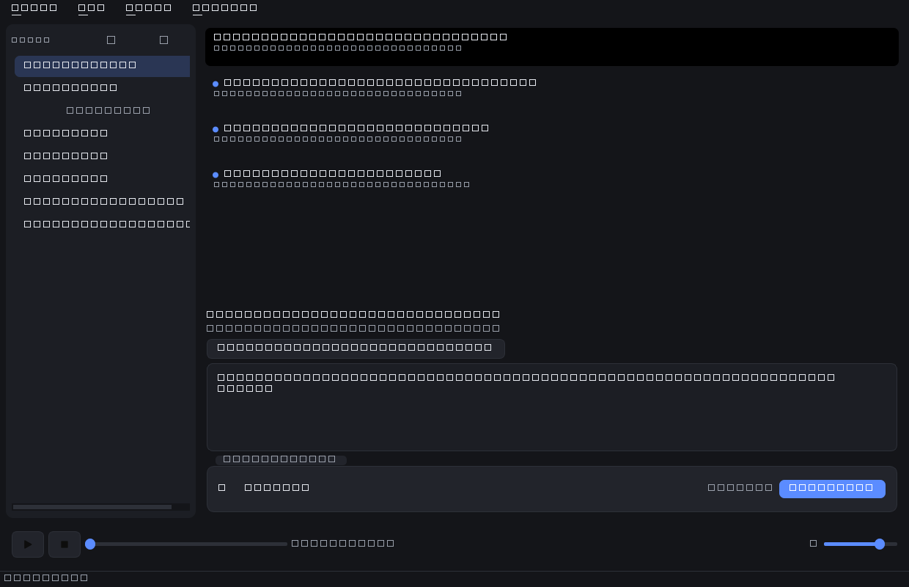

# 📰 RSS Reader — читалка RSS с загрузкой и воспроизведением медиа

Приложение в двух вариантах:

- **Windows** (Python + PySide6) — читайте RSS/Atom-ленты, скачивайте аудио и видео из статей и воспроизводите их прямо в программе.
- **Android** (Kotlin + Jetpack Compose) — то же самое на телефоне: Samsung Galaxy S24 Ultra / S25 FE и любые устройства с Android 10+.



## Возможности

- ➕ Подписка на RSS/Atom-ленты, обновление по F5
- ⏱ **Автообновление лент по расписанию** — от 5 минут до 3 часов (Ленты → Автообновление)
- 📖 Список статей в две строки с датой и лентой, точка у непрочитанных
- 🎧 Обнаружение медиа-вложений в статьях (podcast-enclosures, `media:content`)
- ⬇️ Очередь скачивания с прогрессом; файлы раскладываются по папкам лент
- ▶️ Встроенный плеер: аудио — в нижней панели, видео — в отдельном окне (перемотка, громкость)
- 🎬 Поддержка YouTube/Vimeo/Rutube-ссылок из лент через yt-dlp: видео (mp4) или только звук (mp3/m4a)
- 🌙 **Светлая и тёмная темы** (Ctrl+T; по умолчанию — как в системе)
- 📥 **Импорт/экспорт списка лент в OPML** — лёгкий переезд из других читалок
- 🎨 Собственная иконка приложения и современный плоский интерфейс
- 🗂 Настраиваемая папка загрузок, удаление файлов из программы
- 💾 Все данные локальны: SQLite-база в `%APPDATA%\RSSReader`

## Требования

- Windows 10/11
- Python 3.10+ (тестировалось на 3.14)
- Зависимости из `requirements.txt` (PySide6, feedparser, requests, yt-dlp)
- *Необязательно:* [ffmpeg](https://www.gyan.dev/ffmpeg/builds/) в `PATH` — для склейки YouTube-видео в mp4 и конвертации звука в mp3. Без ffmpeg видео скачивается одним файлом, звук — в m4a.

## Быстрый старт

```bat
git clone https://github.com/USERNAME/rss_reader.git
cd rss_reader
python -m venv .venv
.venv\Scripts\activate
pip install -r requirements.txt
python main.py
```

Вместо venv можно установить зависимости глобально: `pip install -r requirements.txt`.

## Android-версия

Приложение в папке `android/` (Kotlin + Jetpack Compose, Material 3 с динамическими цветами):

- Ленты: добавление/удаление, pull-to-refresh, автообновление каждые 30 минут (WorkManager)
- Статьи: список с непрочитанными, чтение описания, открытие оригинала
- Медиа: скачивание вложений через системный DownloadManager (с уведомлениями и прогрессом), файлы — в `Downloads/RSSReader/<лента>/`
- Плеер: фоновое аудио с медиасессией и мини-плеером, видео — полноэкранный экран со стандартными элементами управления
- Тема: светлая/тёмная следует за системой, на Android 12+ — Material You (цвета обоев)

### Сборка APK

```bash
cd android
gradle assembleDebug
# результат: app/build/outputs/apk/debug/app-debug.apk
```

Требуются JDK 17 и Android SDK (platform 35, build-tools 35). Проще всего собирать в Android Studio: открыть папку `android` как проект → Build → Build APK(s).

Готовый APK для установки: [docs/rss-reader-android.apk](docs/rss-reader-android.apk) (debug-подпись; при установке разрешите «Неизвестные источники»).

## Использование

1. **Добавьте ленту**: кнопка `＋` в списке лент или `Ленты → Добавить ленту` (Ctrl+N). Примеры:
   - `https://feeds.arstechnica.com/arstechnica/index` — новости
   - `https://hnrss.org/frontpage` — Hacker News
   - `https://lexfridman.com/feed/podcast/` — подкаст (mp3)
   - YouTube-канал: `https://www.youtube.com/feeds/videos.xml?channel_id=<ID канала>`
2. **Читайте**: слева ленты, в центре список статей, внизу — описание и вложения.
3. **Скачивайте**: у вложения нажмите `⬇ Скачать` (или `⬇ Видео` / `⬇ Аудио` для YouTube).
4. **Смотрите/слушайте**: кнопка `▶` в статье или на панели «⬇ Загрузки».
5. **Переезд с другого ридера**: `Ленты → Импорт OPML…` / `Экспорт OPML…`.

### Где хранятся данные

| Что | Где |
|---|---|
| База данных | `%APPDATA%\RSSReader\rss_reader.db` |
| Загрузки | `Downloads\RSSReader\<название ленты>\` (настраивается) |

## Структура проекта

```
rss_reader/
├── main.py                  # точка входа Windows-версии (иконка, QApplication)
├── requirements.txt
├── assets/app.ico           # иконка приложения
├── scripts/make_icon.py     # генератор иконки (QPainter → ICO)
├── android/                 # Android-приложение (Kotlin + Jetpack Compose)
│   ├── app/src/main/java/com/rssreader/app/
│   │   ├── data/Db.kt           # Room: ленты, статьи, медиа
│   │   ├── rss/RssParser.kt     # разбор RSS/Atom (enclosure, media:content)
│   │   ├── rss/FeedSyncer.kt    # загрузка и обновление лент (OkHttp)
│   │   ├── downloads/           # очередь загрузок (системный DownloadManager)
│   │   ├── playback/            # фоновый плеер (Media3 ExoPlayer + MediaSession)
│   │   ├── work/SyncWorker.kt   # автообновление каждые 30 минут
│   │   └── ui/                  # экраны (Compose, Material 3)
│   └── ...
└── rss_reader/              # Python-пакет Windows-версии
    ├── db.py                # SQLite-хранилище (ленты, статьи, медиа, настройки)
    ├── feed_worker.py       # фоновое обновление лент
    ├── download_manager.py  # очередь загрузок (requests + yt-dlp)
    ├── player.py            # обёртка QMediaPlayer
    ├── theme.py             # светлая/тёмная тема, QSS-стили
    ├── opml.py              # импорт/экспорт OPML
    ├── utils.py             # утилиты
    └── ui/                  # интерфейс (PySide6)
        ├── main_window.py   # главное окно
        ├── article_delegate.py # отрисовка статей в списке
        ├── details.py       # просмотр статьи + вложения
        ├── downloads_panel.py
        ├── player_bar.py
        └── video_window.py
```

## Публикация на GitHub

Репозиторий уже инициализирован и опубликован. Синхронизация изменений:

```bash
git add -A
git commit -m "Описание изменения"
git push
```

## Лицензия

MIT — см. [LICENSE](LICENSE).
